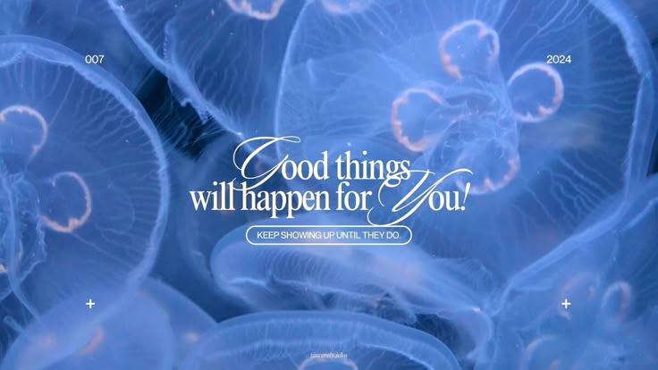

# ✦ HELLO, I'M FRANCISKA ✦

### Pelajar · Aspiring Web Developer

Learning to build websites, one line of code at a time.

[Portfolio](https://ciska-art.github.io/portfolio-webdevku/) ·
[GitHub](https://github.com/ciska-art)

---

## About Me

- 🎓 SMK student majoring in Software Engineering (RPL)
- 🌱 Currently learning HTML and CSS
- 💻 Interested in Web Development
- ✨ Looking for an internship (PKL) opportunity
- 🎯 Goal: Build useful and creative websites

## Tech Stack

## Featured Project

### WebDevKu — Personal Portfolio

My personal portfolio website, built while learning
the fundamentals of HTML and CSS.

[View Portfolio](https://ciska-art.github.io/portfolio-webdevku/)

---

*Still learning, still building, still growing.*

